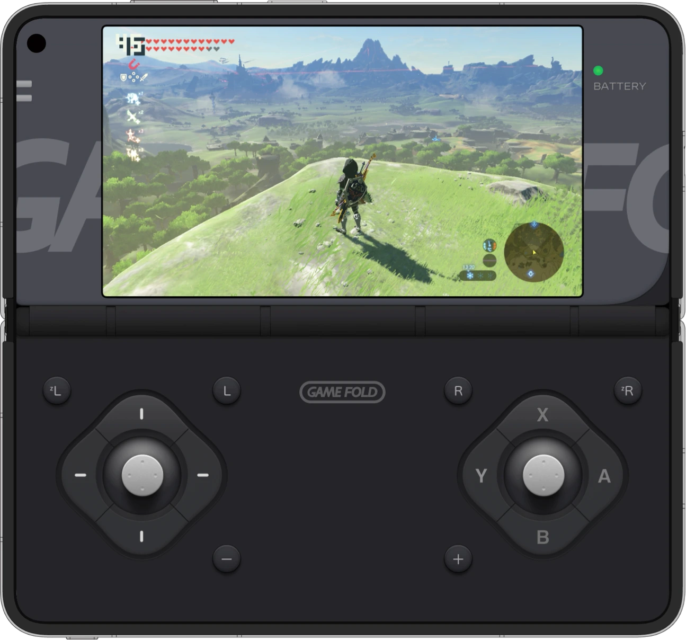

# GameFold NS

> **展开折叠屏，让 Switch 游戏世界在掌心亮起。**  
> Unfold your phone and bring the Switch game world into your hands.

GameFold NS 折叠屏掌机游戏画面 · GameFold NS foldable handheld gameplay

<a href="https://gamefold.pages.dev">访问官网 / Visit website</a> · <a href="https://github.com/lavande16/gamefold-ns/releases/tag/gamefold-ns-3.0-r3-33647389">下载 V3.0 R3 / Download</a>

## 当前版本 · Current release

| 项目 | 信息 |
|---|---|
| 基线 | **GameFold NS 3.0 R3 · versionCode 33647389** |
| Android 包名 | **com.switch.fold.baseline.lite** |
| 下载 | [GitHub Release：GameFold NS 3.0 R3](https://github.com/lavande16/gamefold-ns/releases/tag/gamefold-ns-3.0-r3-33647389) |
| 源码状态 | 以仓库中的 baseline/ 和版本说明为准 |

## 打开折叠屏，进入游戏状态 · Your foldable, ready for game time

- **从游戏库直接开始：**按官网指引安装 GameFold NS、准备 Switch 游戏资源并将完整资源文件夹放入手机根目录；随后从游戏库选择并启动。自动装配功能会处理启动所需的准备步骤。  
  **Start from your game library:** install GameFold NS, prepare Switch game resources and place the complete folder in the device root as guided. Then choose a game from the library; automatic assembly handles the preparation needed for launch.
- **上屏玩游戏，下屏做操作：**展开设备后，游戏画面与 Joy-Con 风格触控布局各有位置，让视线专注在游戏、手指专注在操作。  
  **Play above, control below:** when unfolded, the game takes the upper display while Joy-Con-style touch controls sit below, giving gameplay and input their own space.
- **常用操作就在拇指附近：**D-pad、摇杆与核心按键按双手握持时的自然落点组织，减少触屏寻找按键的感觉。  
  **Core controls within thumb reach:** the D-pad, sticks and action buttons follow the natural thumb positions of a two-handed grip, making touch input feel easier to follow.
- **背屏也能成为辅助输入区：**在支持的折叠屏设备上，可将背面屏幕用于额外触控按键，并配合多指协同操作。  
  **Put the rear display to work:** on supported foldable devices, use the back screen for extra touch buttons and coordinate multiple fingers.
- **触控操作带有声音与震动反馈：**按键和摇杆的反馈帮助确认输入；可用效果取决于设备支持。  
  **Feedback for touch controls:** custom sounds and vibration for buttons and sticks help confirm each input; available effects depend on device support.

> GameFold 是个人的非商业折叠屏游戏体验项目。仓库不含第三方游戏文件；相关品牌与商标归各自权利人所有，本项目与其没有隶属、合作或授权关系。  
> GameFold is a personal, non-commercial foldable gaming project. Third-party game files are not included. All third-party names and marks belong to their respective owners; this project is not affiliated with or endorsed by them.

## 从这个基线继续 · Build on this baseline

仓库保留 GameFold NS 3.0 R3 的源码与基线资料。后续开发请以 Release 和 baseline/ 中的记录为起点，保留原始基线与其验证材料。阅读 [自动装配说明](GAMEFOLD_AUTOPACK_V1.md)、[Lite 基线说明](GAMEFOLD_LITE_V1_BASELINE.md)、[源码快照说明](SOURCE_SNAPSHOT.md) 和 [基线目录](baseline/)。

This repository keeps the GameFold NS 3.0 R3 source and baseline materials. Use the Release and records under baseline/ as the starting point for future work, preserving the accepted baseline and its evidence. See the [auto-assembly guide](GAMEFOLD_AUTOPACK_V1.md), [Lite baseline](GAMEFOLD_LITE_V1_BASELINE.md), [source snapshot notes](SOURCE_SNAPSHOT.md) and [baseline files](baseline/).

## GameFold / GamePad 产品矩阵 · Product family

GameFold 面向折叠屏手机，GamePad 面向 Android 平板。  
GameFold is for foldable phones; GamePad is for Android tablets.

| 产品线 / Product | 仓库 / Repository | 官网 / Website | 描述 / Description |
|---|---|---|---|
| GameFold NS | [gamefold-ns](https://github.com/lavande16/gamefold-ns) | [GameFold](https://gamefold.pages.dev) | 在折叠屏手机上运行 Switch 游戏。 Run Switch games on a foldable phone. |
| GameFold PC | [gamefold-pc](https://github.com/lavande16/gamefold-pc) | [GameFold](https://gamefold.pages.dev) | 在折叠屏手机上运行 PC 游戏。 Run PC games on a foldable phone. |
| GameFold FC | [gamefold-fc](https://github.com/lavande16/gamefold-fc) | [GameFold FC](https://game-fold.pages.dev) | 在折叠屏手机上运行 FC 游戏。 Run FC games on a foldable phone. |
| GamePad NS | [gamepad-ns](https://github.com/lavande16/gamepad-ns) | [GameFold](https://gamefold.pages.dev) | 在 Android 平板上运行 Switch 游戏。 Run Switch games on an Android tablet. |
| GamePad PC | [gamepad-pc](https://github.com/lavande16/gamepad-pc) | [GameFold](https://gamefold.pages.dev) | 在 Android 平板上整理并启动本地 PC 游戏。 Organize and launch local PC games on an Android tablet. |
| GamePad PS | [gamepad-ps](https://github.com/lavande16/gamepad-ps) | [GameFold](https://gamefold.pages.dev) | 在 Android 平板上畅玩自己的 PS2 游戏库。 Play your PS2 library on an Android tablet. |

---

源码与基线备份 · Source and baseline backup · 版本信息以对应 Release 为准 · Check the linked Release for the current baseline

